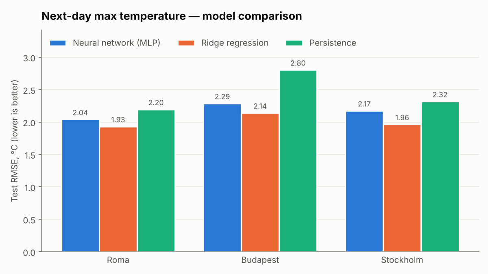
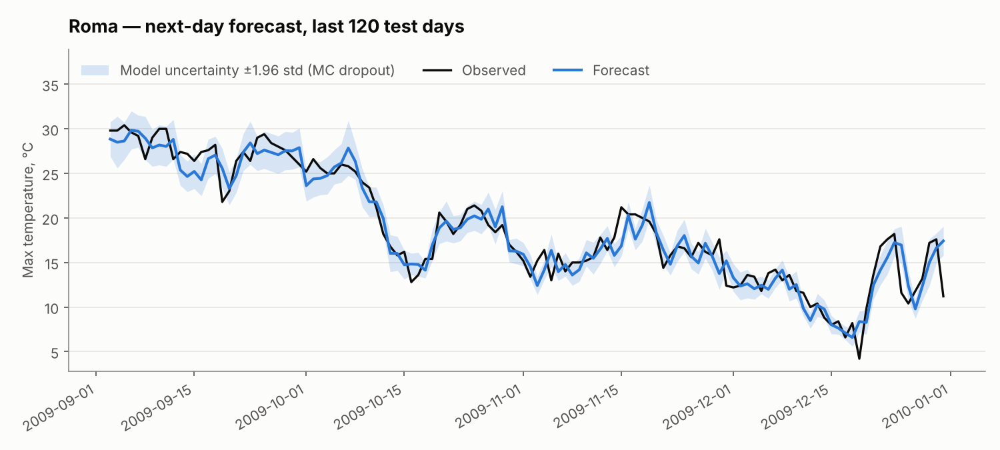
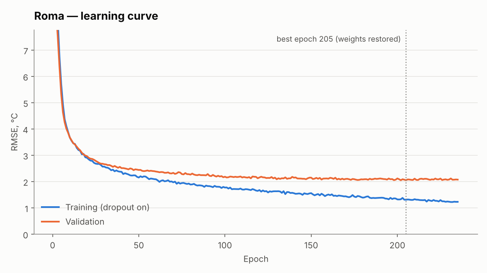
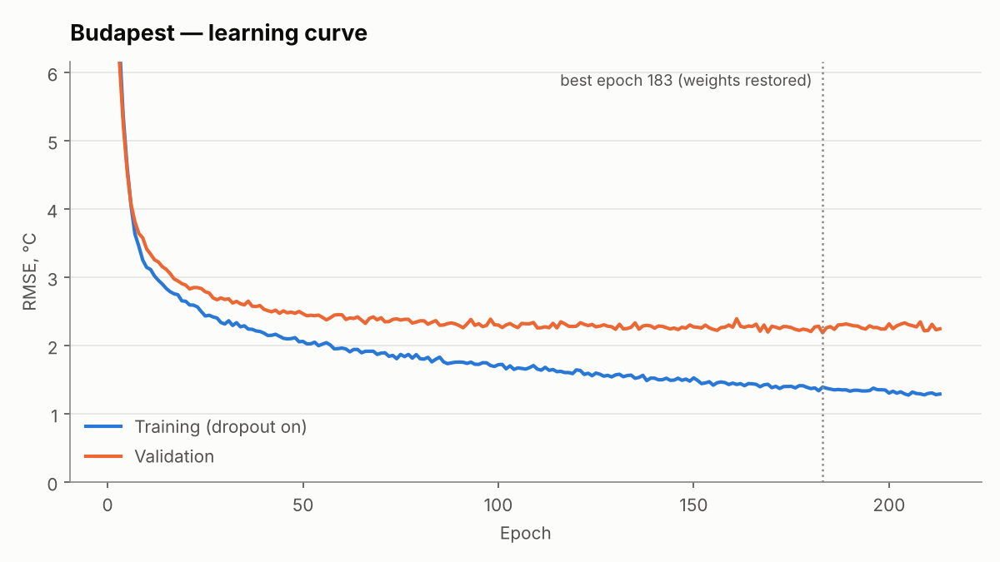
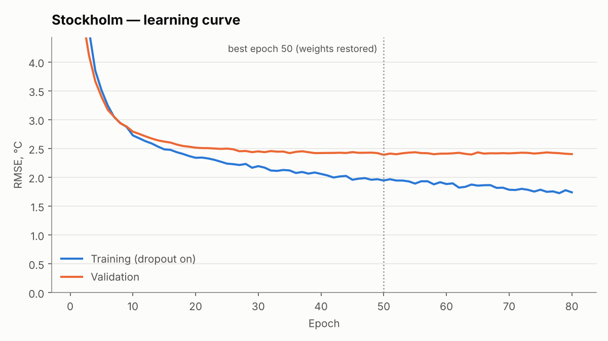
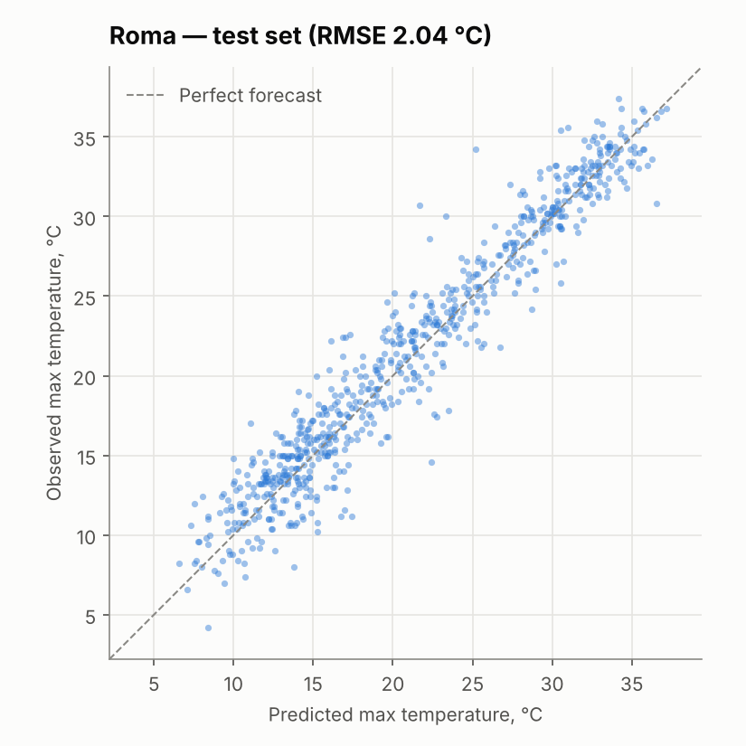
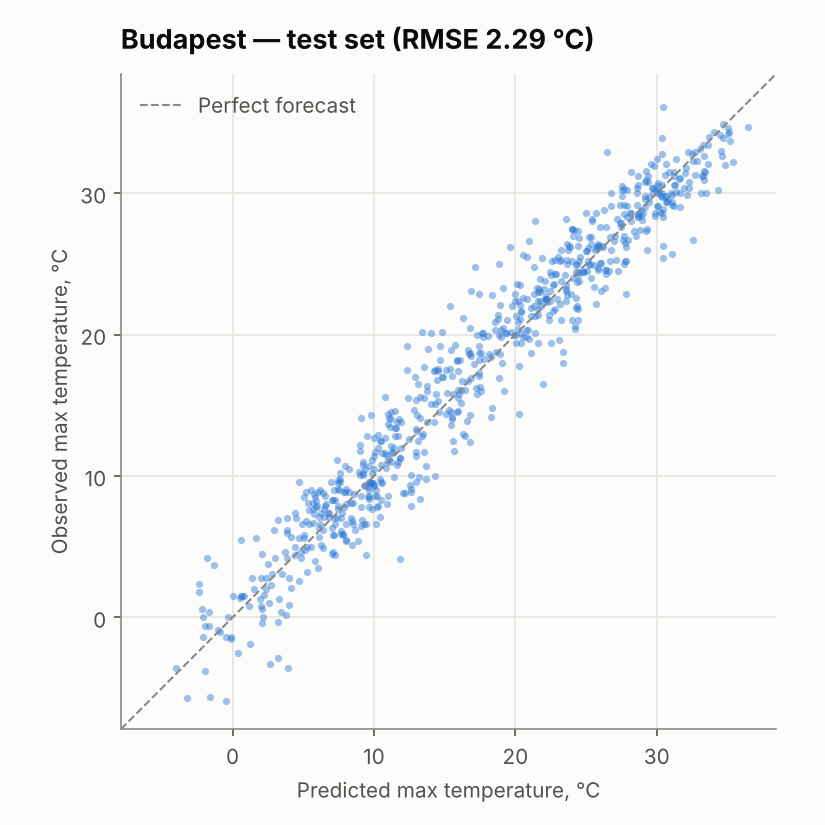
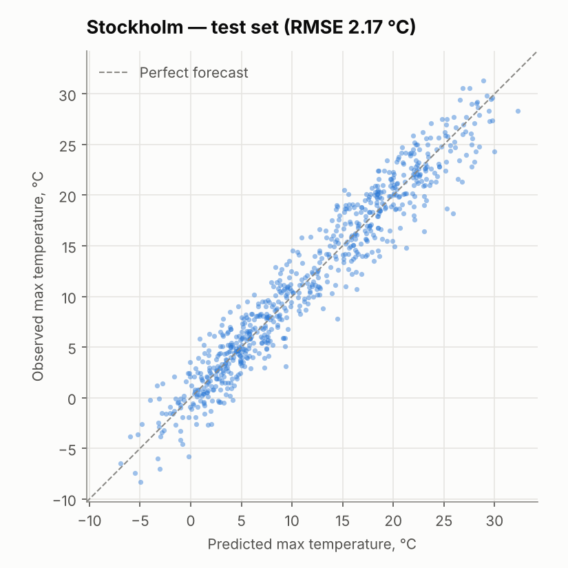

# Next-day maximum temperature forecasting

[](https://github.com/CherkasovAndrii/Python_Weather_Prediction_Max_Temp/actions/workflows/ci.yml)


[](LICENSE)

Forecast **tomorrow's maximum air temperature** in Rome, Budapest and Stockholm from today's weather
observations at 18 European stations. The project compares a neural network
(Keras MLP with Monte Carlo dropout) against two honest baselines and reports
which one actually works best.



## Highlights

- **Leak-free evaluation.** Data are split *chronologically* (train 2000–2006, validation 2007,
  test 2008–2009) instead of at random, so the model never trains on days after the ones it is tested on.
- **Baselines first.** Every model is compared with *persistence* ("tomorrow = today") and a
  regularised linear model (Ridge). The neural network has to earn its complexity.
- **Data-quality checks.** 35 sentinel values for missing data (e.g. cloud cover = −99, air pressure = 0)
  were found in the raw CSV and are cleaned automatically. Before this fix, the network's test RMSE was
  4–6 °C instead of ~2 °C.
- **Uncertainty estimates** for each forecast with Monte Carlo dropout.
- **Reproducible:** fixed seeds, one command to re-create all metrics and figures, 40+ automated tests
  with ~99 % coverage, linting and CI on GitHub Actions.

## Results

Test period 2008-01-01 – 2009-12-31 (731 forecasts per city). Lower RMSE/MAE is better.

| City | Model | RMSE, °C | MAE, °C | R² |
|------|-------|---------:|--------:|---:|
| Rome | Persistence | 2.20 | 1.62 | 0.921 |
| Rome | Ridge regression | **1.93** | **1.49** | **0.939** |
| Rome | Neural network | 2.04 | 1.55 | 0.932 |
| Budapest | Persistence | 2.80 | 2.14 | 0.917 |
| Budapest | Ridge regression | **2.14** | **1.70** | **0.952** |
| Budapest | Neural network | 2.29 | 1.78 | 0.945 |
| Stockholm | Persistence | 2.32 | 1.78 | 0.928 |
| Stockholm | Ridge regression | **1.96** | **1.55** | **0.948** |
| Stockholm | Neural network | 2.17 | 1.72 | 0.936 |

**What this shows**

1. Both learned models beat persistence everywhere. Ridge cuts the error by 12–24 %, the neural network by 6–18 %.
2. **Ridge regression is the most accurate model.** Tomorrow's temperature is almost a linear function of
   today's temperatures (correlation up to 0.96, see the [notebook](notebooks/exploration.ipynb)). With only
   ~2,500 training days and 165 strongly correlated features, the extra capacity of a neural network mostly adds
   variance. The network came out behind on the validation set as well, before the test set was ever used
   (see [Hyper-parameter selection](#hyper-parameter-selection)).
3. **MC-dropout uncertainty is too narrow.** The ±1.96 std band covers only 59–65 % of the observations
   instead of 95 %. Dropout captures *model* uncertainty but not the day-to-day noise of the weather itself,
   so the band should not be read as a real 95 % prediction interval.



<details>
<summary>More figures: learning curves and predicted vs. observed</summary>

| | Rome | Budapest | Stockholm |
|---|---|---|---|
| Learning curve |  |  |  |
| Test set |  |  |  |

</details>

## Method

| Step | Details |
|------|---------|
| Features | All 163 observations of day *t* from 18 stations (temperature, humidity, pressure, radiation, precipitation, sunshine, cloud cover, wind), plus the day of the year encoded as `sin`/`cos` |
| Target | `<CITY>_temp_max` on day *t + 1* |
| Cleaning | Physically impossible values are replaced with the last valid observation (forward fill, so only past data is used) |
| Split | Chronological: train ≤ 2006-12-31 < validation ≤ 2007-12-31 < test |
| Persistence | ŷ(t+1) = temp_max(t) |
| Ridge | `StandardScaler` + `RidgeCV` (α chosen by cross-validation on the training set) |
| Neural network | `Normalization` (adapted on training data, saved inside the model) → Dense 64 ReLU → Dropout 0.1 → Dense 32 ReLU → Dense 1. L2 = 1e-3, Adam (lr 3e-4), MSE loss, early stopping on validation loss (patience 30, best weights restored) |
| Uncertainty | 100 forward passes with dropout active (Monte Carlo dropout) → mean = forecast, std = uncertainty |

### Hyper-parameter selection

Network settings were chosen by **validation** RMSE (year 2007, mean of 50 MC-dropout passes).
The test set was used only once, for the final table above.

| Config | Layers | Dropout | L2 | LR | Rome | Budapest | Stockholm | Mean |
|--------|--------|--------:|---:|---:|-----:|---------:|----------:|-----:|
| A | 100-50-10 | 0.2 | – | 1e-3 | 2.46 | 2.46 | 2.60 | 2.51 |
| B | 100-50-10 | 0.2 | – | 1e-4 | 2.20 | 2.28 | 2.46 | 2.31 |
| C | 100-50-10 | 0.2 | 1e-3 | 3e-4 | 2.23 | 2.48 | 2.40 | 2.37 |
| D | 100-50-10 | 0.2 | 1e-2 | 1e-4 | 2.10 | 2.25 | 2.37 | 2.24 |
| E | 100-50-10, batch 64 | 0.3 | 1e-3 | 3e-4 | 2.30 | 2.48 | 2.47 | 2.42 |
| **F (selected)** | **64-32** | **0.1** | **1e-3** | **3e-4** | **2.04** | **2.18** | **2.40** | **2.21** |
| *Ridge (reference)* | | | | | *1.88* | *2.07* | *2.23* | *2.06* |

## Quick start

```bash
git clone https://github.com/CherkasovAndrii/Python_Weather_Prediction_Max_Temp.git
cd Python_Weather_Prediction_Max_Temp

python -m venv .venv
source .venv/bin/activate          # Windows: .venv\Scripts\activate
pip install -e ".[dev]"
```

```bash
maxtemp cities                     # list the 18 available locations
maxtemp train                      # Rome, Budapest, Stockholm → reports/ and models/
maxtemp train --cities OSLO DE_BILT --epochs 200 --seed 7
maxtemp --help
```

`maxtemp train` writes:

- `reports/metrics.json`: all metrics, the full configuration and the data-cleaning log
- `reports/results.md`: the results table
- `reports/figures/*.png`: learning curves, scatter plots, forecast plots, model comparison
- `models/<city>_mlp.keras`: trained networks; they take raw observations because normalisation is built into the model

A full run takes about 2–3 minutes on a laptop CPU.

## Development

```bash
pytest                             # all tests (≈25 s)
pytest -m "not slow"               # skip the tests that train a network
pytest --cov                       # with coverage report
ruff check . && ruff format --check .
```

The test suite covers:

- **Data:** loading, target alignment (`y[t] == temp_max[t+1]`), no overlap between the time splits, sentinel cleaning, and quality checks on the committed CSV (shape, gaps, plausible ranges).
- **Models:** the persistence and Ridge baselines, metric correctness and interval coverage.
- **Neural network:** output shape, reproducibility with a fixed seed, and MC-dropout behaviour.
- **End to end:** the `maxtemp train` CLI on synthetic data.

CI (GitHub Actions) runs the linter and the test suite on Python 3.10, 3.11 and 3.12 for every push and pull request.

## Project structure

```
├── data/
│   ├── README.md                  # dataset description, units, citation
│   └── weather_prediction_dataset.csv
├── notebooks/
│   └── exploration.ipynb          # EDA, data-quality findings, results summary
├── reports/
│   ├── figures/                   # generated plots (committed for this README)
│   ├── metrics.json
│   └── results.md
├── src/maxtemp/
│   ├── config.py                  # all hyper-parameters in dataclasses
│   ├── data.py                    # loading, cleaning, supervised framing, time split
│   ├── baselines.py               # persistence and Ridge
│   ├── nn.py                      # Keras MLP + Monte Carlo dropout
│   ├── metrics.py                 # RMSE, MAE, R², interval coverage
│   ├── plots.py                   # report figures
│   ├── pipeline.py                # end-to-end experiment
│   └── cli.py                     # `maxtemp` command
├── tests/                         # pytest suite
├── .github/workflows/ci.yml
└── pyproject.toml
```

## Possible next steps

- Add lagged features (the last 3–7 days) and test gradient-boosted trees.
- Calibrate the uncertainty, for example by predicting a mean and a variance (Gaussian NLL loss) or with conformal prediction.
- Use a rolling-origin cross-validation instead of a single time split.

## Data

[Weather prediction dataset](https://doi.org/10.5281/zenodo.7525955) by Huber, F., van Kuppevelt, D.,
Steinbach, P., Sauze, C., Liu, Y. and Weel, B. (2022), licensed under
[CC BY 4.0](https://creativecommons.org/licenses/by/4.0/). Described in:
*Will the sun shine? An accessible dataset for teaching machine learning and deep learning*,
[PMLR 207 (2023)](https://proceedings.mlr.press/v207/huber23a.html).

Original observations from the European Climate Assessment & Dataset (ECA&D):
Klein Tank, A.M.G. and Coauthors, 2002. *Daily dataset of 20th-century surface air temperature and
precipitation series for the European Climate Assessment.* Int. J. of Climatol., 22, 1441–1453.
Data and metadata available at <https://www.ecad.eu>.

See [`data/README.md`](data/README.md) for column descriptions and units.

## License

Code: [MIT](LICENSE). Dataset: CC BY 4.0 (see above).

## Author

**Andrii Cherkasov**, [GitHub](https://github.com/CherkasovAndrii)
